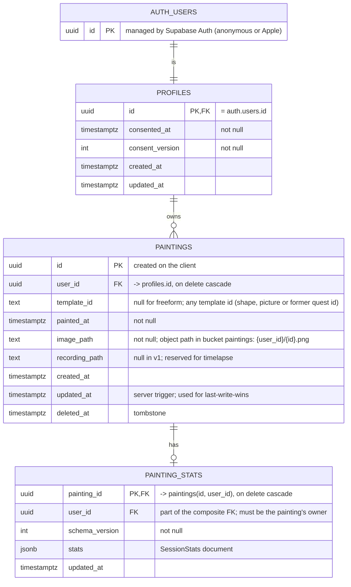

# Supabase data model (ERD)

Contract for chunk 0.3 of [backlog.md](backlog.md). Decisions behind it are in [ADR 0001](adr/0001-backend-architecture.md).

## Entity relationship



There is no `daily_quest` table: the quest of the day is computed on the client (ADR 0001, decision 7).

## Notes per table

**`profiles`**
- One row per account, created right after consent and the first anonymous sign-in.
- Holds no personal data on purpose: no name, no email, no birth date. Email, when the account is upgraded, stays in `auth.users`.

**`paintings`**
- `id` is generated on the client so a retried insert is idempotent.
- `template_id` carries any template id (an abstract shape, one of the first ten pictures, or a newer picture; ids never change), because the Report's quest star is derived from it.
- Unlock state does not exist: every template is open from the start (ADR 0001, decision 8, amended 7 Nov 2026). If a progression comes back, derive it from the non-deleted paintings; do not store it.
- Index: `(user_id, painted_at desc) where deleted_at is null`.
- A trigger sets `updated_at = now()` on update.

**`painting_stats`**
- Optional: a painting made by touch has no movement data and no row.
- `stats` is a JSON document with the existing `SessionStats` content (painting time, heatmap, grip cycles, ROM values, lean flag, hand dominance). The prototype added `sideHeatmaps` (the heatmap per hand); it is optional when decoding, so it can be added to Rona's type without a migration. `schema_version` lets the format evolve without migrations.
- Follows its painting: a tombstoned painting's stats are ignored by the client, and the row cascades if the painting row is ever purged.

## Storage

- One private bucket `paintings`. Object path: `{user_id}/{painting_id}.png`.
- Reserved for later: `{user_id}/{painting_id}.rec` for the timelapse recording.
- Storage objects do not cascade from table deletes. The `delete-account` function removes the user's objects first, then the auth user.

## Row level security

All policies apply to role `authenticated`. Anonymous users are authenticated users with `auth.uid()`, so the same policies cover them.

| Table | Select | Insert | Update | Delete |
|---|---|---|---|---|
| `profiles` | `id = auth.uid()` | `id = auth.uid()` | `id = auth.uid()` | via `delete-account` only |
| `paintings` | `user_id = auth.uid()` | `user_id = auth.uid()` | `user_id = auth.uid()` | `user_id = auth.uid()` (normally a tombstone update instead) |
| `painting_stats` | `user_id = auth.uid()` | `user_id = auth.uid()` | `user_id = auth.uid()` | `user_id = auth.uid()` |
| `storage.objects` (bucket `paintings`) | `(storage.foldername(name))[1] = auth.uid()::text` | same | same | same |

The composite foreign key `(painting_id, user_id)` on `painting_stats` already guarantees that stats belong to a painting of the same user, so the policies do not need to check it again.

## Edge function

- `delete-account` (required by App Store guideline 5.1.1(v)): verify the caller, delete their Storage objects, then delete the auth user. The `on delete cascade` chain removes `profiles`, `paintings` and `painting_stats`.
## Swift contracts (sketch)

```swift
struct Painting: Identifiable, Equatable {
    let id: UUID
    var templateID: String?
    var paintedAt: Date
    var hasRecording: Bool        // local timelapse only in v1
    var deletedAt: Date?
}

protocol GalleryRepository {
    func paintings() async throws -> [Painting]            // non-deleted, newest first
    func imageData(for id: Painting.ID) async throws -> Data
    func save(_ painting: Painting, png: Data) async throws
    func delete(id: Painting.ID) async throws              // tombstone
}

protocol StatsRepository {
    func stats(for id: Painting.ID) async throws -> SessionStats?
    func save(_ stats: SessionStats, for id: Painting.ID) async throws
}

protocol QuestSource {
    func quest(on date: Date) -> Quest                     // pure, no I/O
}
```

Two implementations of the first two protocols: `LocalGalleryStore` (what the UI reads) and the Supabase repositories (used only by the sync engine). Pages never talk to Supabase directly.

## Client-side state that is not in the database

- Local consent flag and version (`ConsentStore`).
- Timelapse recordings, next to each painting's PNG (the stroke recording and the camera timelapse, which holds small camera snapshots of the child and never leaves the device).
- Outbox of pending sync operations.
- Camera and device-only settings.

## Open points for later

- Purge job for old tombstones.
- Cleanup job for abandoned anonymous users that never saved a painting.
- Upload of timelapse recordings, once their size is measured.
